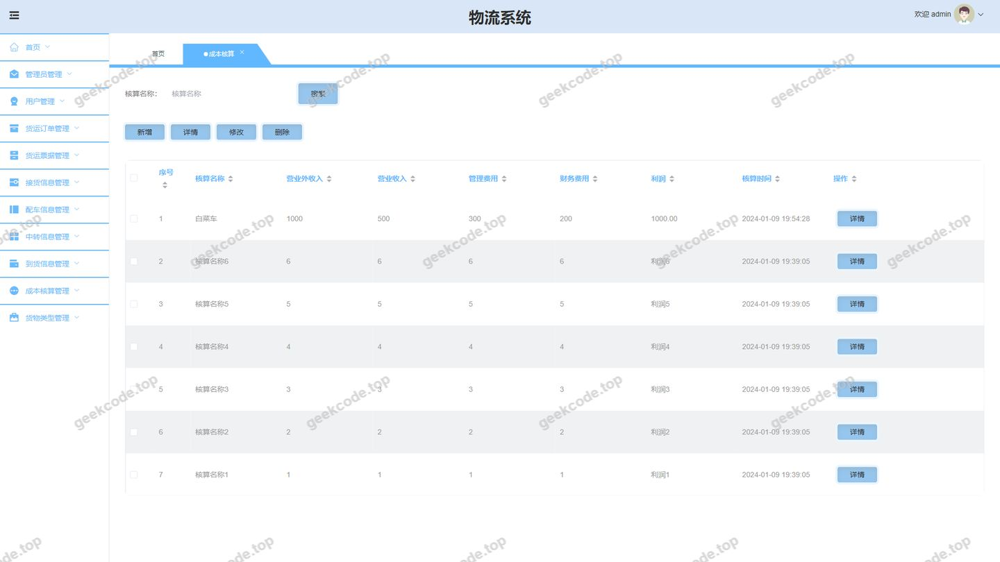
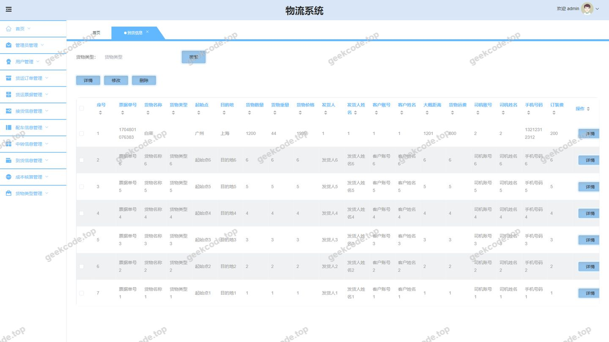
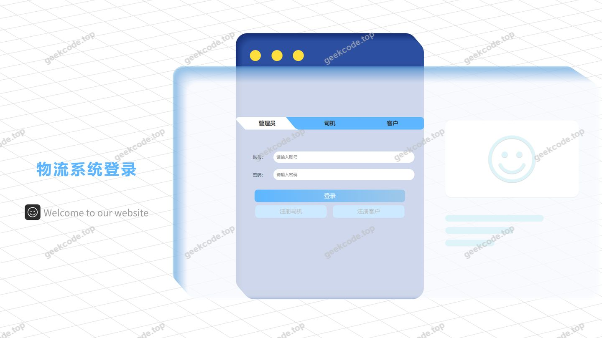
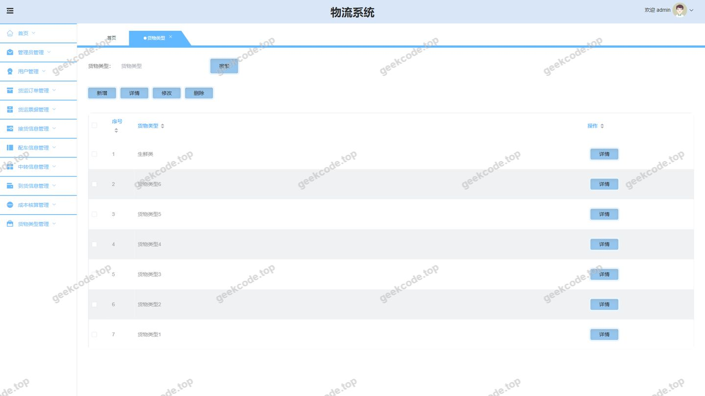
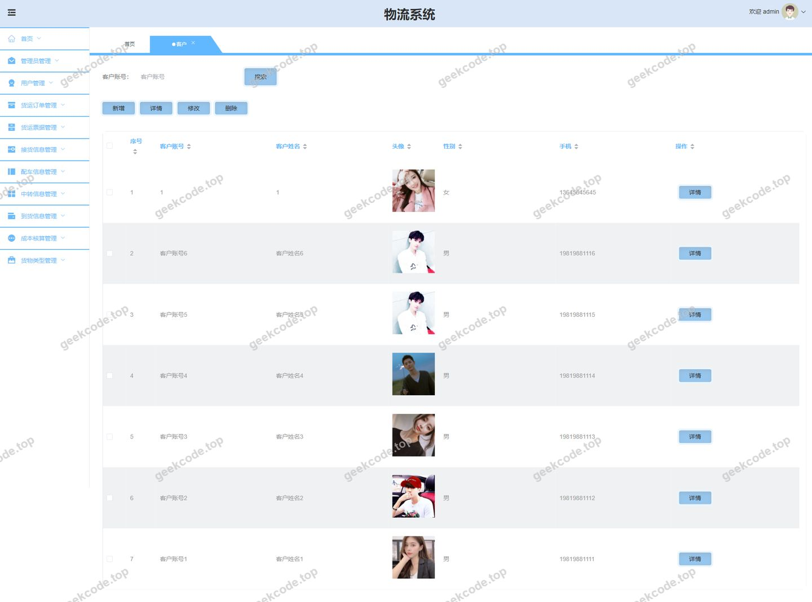
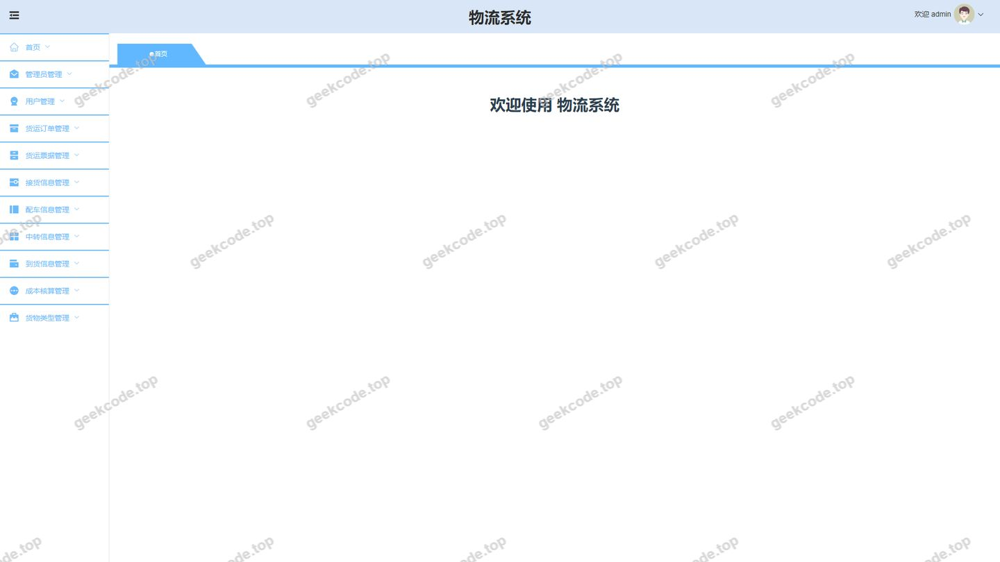
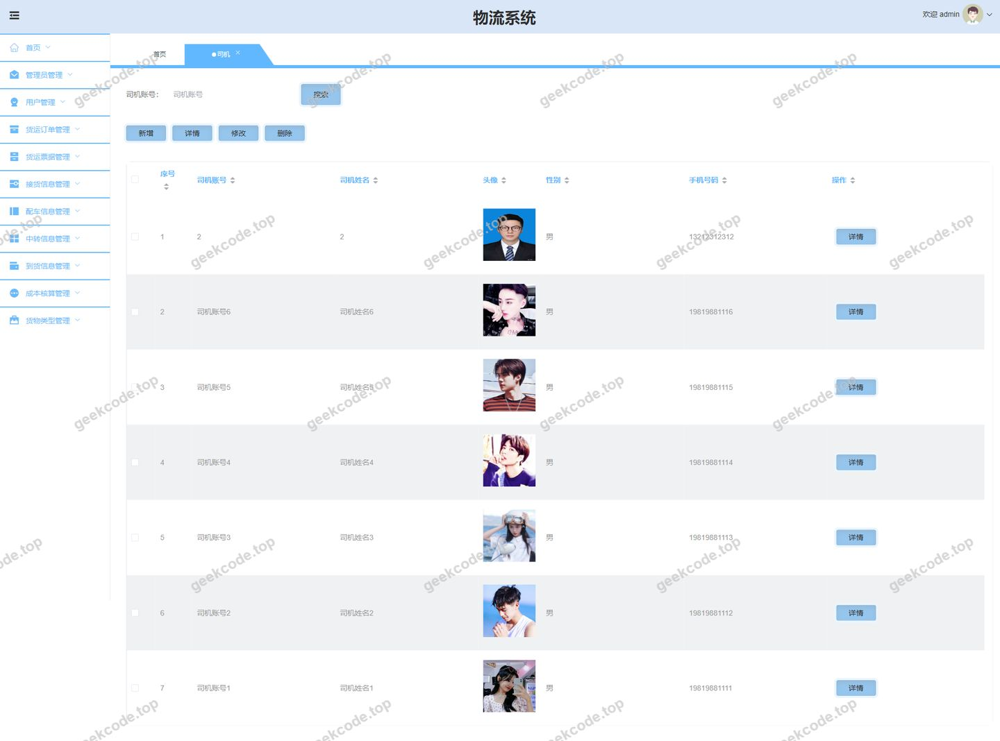
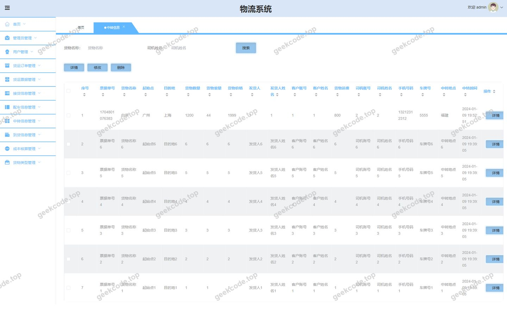

# springboot + vue 物流系统

> 🎓 **计算机毕业设计 · springboot + vue 物流系统**
>
> 本仓库只放**项目介绍 + 运行截图**（截图是站点带水印的原图，存在仓库 `images/` 里）。
>
> 👉 **完整可运行源码 / 数据库脚本 / 部署文档：[点我获取](https://geekcode.top/archives/springboot-vue-%E7%89%A9%E6%B5%81%E7%B3%BB%E7%BB%9F?utm_source=github)**
>
> 💬 咨询微信：**ir9372**　|　🌐 更多项目：[极客代码 geekcode.top](https://geekcode.top/?utm_source=github)
>
> 📌 项目详情页：<https://geekcode.top/archives/springboot-vue-%E7%89%A9%E6%B5%81%E7%B3%BB%E7%BB%9F?utm_source=github>

<table><td width="230" align="center"> <b>扫码加微信 ir9372</b></td><td valign="middle">📦 源码 = 项目介绍 + 全部运行截图 + 数据库 + 部署文档 👉 点上方任意截图，直接跳到 <b>极客代码 geekcode.top</b> 详情页</td></table>

---

<h1>springboot + vue 物流系统</h1>
<h2>项目概述</h2>

本项目为基于 Spring Boot 与 Vue 技术栈构建的物流管理系统，旨在实现物流业务全流程的数字化管理。系统核心功能涵盖货物类型维护、司机与客户信息管理、中转及到货信息追踪、配车与提货处理、成本核算以及公告发布等模块。适用人群包括物流企业管理者、调度人员及一线操作人员。技术架构采用前后端分离模式，后端基于 Spring Boot 结合 MyBatis-Plus 进行数据持久化，使用 Shiro 框架保障系统安全；前端通过 Vue 实现动态交互界面。该系统有效解决了传统物流管理中信息分散、调度效率低及成本统计滞后等问题，提升了物流企业的运营透明度与管理效能。

<h2>技术架构</h2>

本系统采用典型的前后端分离架构设计，确保系统的高内聚低耦合特性。

<strong>后端架构</strong>
后端服务基于 Java 语言开发，核心框架选用 Spring Boot，利用其自动配置特性简化部署流程。数据访问层采用 MyBatis-Plus 作为 ORM 框架，相比原生 MyBatis，它提供了更便捷的 CRUD 操作接口及分页插件支持，显著提升了开发效率。数据库连接池使用 Spring JDBC Starter，驱动依赖 MySQL Connector。安全控制方面，集成 Apache Shiro 框架，负责身份认证（Authentication）和授权（Authorization），确保只有合法用户才能访问特定资源。此外，引入 Protobuf 用于高效的数据序列化，Commons Lang3 提供基础工具类支持。

<strong>前端架构</strong>
前端采用 Vue.js 框架构建单页应用（SPA）。虽然具体前端路由细节未在源码中完全展示，但根据后台路由结构推断，前端通过 Axios 或类似 HTTP 客户端与后端 RESTful API 进行通信，实现数据的异步加载与页面动态渲染。

<strong>数据库设计要点</strong>
数据库选用 MySQL，依据业务实体关系设计了多个核心表，包括但不限于：

<ol>
<li><strong>基础信息表</strong>：存储司机（Siji）、客户（Kehu）、货物类型（Huowuleixing）等静态数据。</li>
<li><strong>业务流程表</strong>：记录中转信息（Zhongzhuanxinxi）、提货信息（Jiehuoxinxi）、配车信息（Peichexinxi）、到货信息（Daohuoxinxi）。</li>
<li><strong>财务与单据表</strong>：包含成本核算（Chengbenhesuan）、货运订单（Huoyundingdan）、货运票据（Huoyunpiaoju）。</li>
<li><strong>系统管理表</strong>：存储公告信息（Gonggaoxinxi）及用户权限相关数据。</li>
</ol>

各表之间通过外键关联，形成完整的物流业务数据闭环，确保数据的一致性与完整性。

<h2>功能模块</h2>

根据后台路由配置及截图所示，系统主要划分为以下功能模块：

<h3>后台管理端功能</h3>
<ol>
<li>
<strong>登录与注册模块</strong>

<ul>
<li><strong>管理员登录</strong>：提供系统入口，验证用户身份。</li>
<li><strong>司机注册/客户注册</strong>：允许新用户录入基本信息并获取系统账号，便于后续业务操作。</li>
</ul>
</li>
<li>
<strong>基础信息管理</strong>

<ul>
<li><strong>货物类型管理</strong>：定义和维护物流货物的分类标准，如普通货物、危险品、冷链货物等。</li>
<li><strong>司机管理</strong>：录入司机个人信息、驾驶证号、联系方式及所属车队，支持增删改查。</li>
<li><strong>客户管理</strong>：维护客户档案，包括企业名称、联系人、地址及历史合作记录。</li>
</ul>
</li>
<li>
<strong>物流业务执行</strong>

<ul>
<li><strong>提货信息管理</strong>：记录上门提货的时间、地点、货物明细及经办人。</li>
<li><strong>中转信息管理</strong>：跟踪货物在中转站的入库、出库及转运状态。</li>
<li><strong>配车信息管理</strong>：根据货物体积、重量及目的地，安排合适的运输车辆及司机。</li>
<li><strong>到货信息管理</strong>：确认货物送达情况，记录签收时间及异常反馈。</li>
</ul>
</li>
<li>
<strong>财务与单据管理</strong>

<ul>
<li><strong>成本核算</strong>：计算单次运输或批量运输的成本，包括油费、过路费、人工费等，生成报表。</li>
<li><strong>货运订单管理</strong>：创建、审核及查询客户的运输委托订单。</li>
<li><strong>货运票据管理</strong>：生成和管理相关的运输发票或收据凭证。</li>
</ul>
</li>
<li>
<strong>信息发布</strong>

<ul>
<li><strong>公告信息管理</strong>：发布物流政策变更、节假日安排或紧急通知，确保内部信息同步。</li>
</ul>
</li>
<li>
<strong>个人中心</strong>

<ul>
<li><strong>司机中心</strong>：供已登录司机查看个人任务、历史记录及修改个人资料。</li>
<li><strong>客户中心</strong>：供已登录客户查询订单进度、账单详情及维护联系信息。</li>
</ul>
</li>
</ol>

<em>(注：根据现有上下文，前台无独立导航菜单及个人中心菜单，所有用户交互均通过上述后台路由对应的页面完成，或通过特定的注册/登录入口进入相应角色视图。)</em>

<h2>用户角色与权限</h2>

系统基于 Shiro 框架实现细粒度的权限控制，主要包含以下三类角色：

<ol>
<li>
<strong>超级管理员 (Admin)</strong>

<ul>
<li><strong>权限范围</strong>：拥有系统最高权限，可访问所有后台路由。</li>
<li><strong>具体功能</strong>：</li>
<li>管理所有基础数据（货物类型、司机、客户）。</li>
<li>监控全链路物流状态（提货、中转、配车、到货）。</li>
<li>执行财务操作（成本核算、订单审核、票据开具）。</li>
<li>发布系统公告。</li>
<li>审核司机与客户的注册申请。</li>
</ul>
</li>
<li>
<strong>司机 (Driver)</strong>

<ul>
<li><strong>权限范围</strong>：受限访问，主要关注个人任务与基础信息。</li>
<li><strong>具体功能</strong>：</li>
<li><strong>司机中心 (/sijiCenter)</strong>：查看分配给自己的配车任务、提货指令及到货确认需求。</li>
<li><strong>司机注册 (/sijiRegister)</strong>：新司机自行录入信息进行注册。</li>
<li>仅能查看与自己相关的订单和运单信息，无法访问其他司机的数据或进行全局成本核算。</li>
</ul>
</li>
<li>
<strong>客户 (Customer)</strong>

<ul>
<li><strong>权限范围</strong>：受限访问，主要关注自身订单与服务进度。</li>
<li><strong>具体功能</strong>：</li>
<li><strong>客户中心 (/kehuCenter)</strong>：查询名下货运订单的状态（待提货、运输中、已到货）、查看运费账单及电子票据。</li>
<li><strong>客户注册 (/kehuRegister)</strong>：新客户自助注册账号。</li>
<li>无法访问后台管理页面的敏感数据（如其他客户信息、内部成本明细、司机详细档案等）。</li>
</ul>
</li>
</ol>
<h2>项目特色与创新点</h2>
<ol>
<li>
<strong>全流程可视化管控</strong>
系统覆盖了从“提货”到“中转”、“配车”直至“到货”的完整物流生命周期。通过模块化设计，管理者可以实时监控货物在每一个节点的流转状态，消除了传统物流中的“黑盒”现象，极大提升了调度响应速度。

</li>
<li>
<strong>精细化成本核算体系</strong>
区别于一般物流系统仅记录收入，本项目专门设计了“成本核算”与“货运票据”模块。通过将油费、人工、中转费用等直接关联至具体订单，实现了单车、单线的利润精准分析，为企业定价策略和成本控制提供了数据支撑。

</li>
<li>
<strong>多角色协同机制</strong>
通过区分“司机中心”与“客户中心”，系统实现了 B2B 与 B2C 场景的融合。司机可直接接收调度指令并反馈执行结果，客户可自助查询进度，减少了中间沟通环节的人力成本，提升了多方协作效率。

</li>
<li>
<strong>安全性与规范性并重</strong>
引入 Shiro 框架进行统一的安全管理，确保了不同角色间的数据隔离。同时，标准化的货物类型管理和公告发布机制，使得企业内部操作流程更加规范，降低了人为操作失误的风险。

</li>
</ol>
<h2>部署环境</h2>

为确保系统稳定运行，需准备以下软件环境：

<ol>
<li>
<strong>后端运行环境</strong>

<ul>
<li><strong>JDK</strong>: Java Development Kit 8 或更高版本（建议 JDK 8, 11, 或 17，需与 Spring Boot 版本兼容）。</li>
<li><strong>Maven</strong>: 用于依赖管理和项目构建。</li>
<li><strong>MySQL</strong>: 版本 5.7 或 8.0+，需初始化数据库表结构并导入基础数据。</li>
</ul>
</li>
<li>
<strong>前端运行环境</strong>

<ul>
<li><strong>Node.js</strong>: LTS 版本（如 v14.x 或 v16.x），用于编译 Vue 项目。</li>
<li><strong>NPM/Yarn</strong>: 包管理工具，用于安装前端依赖库。</li>
</ul>
</li>
<li>
<strong>服务器环境</strong>

<ul>
<li><strong>操作系统</strong>: Linux (CentOS 7+, Ubuntu 18+) 或 Windows Server。</li>
<li><strong>Web 服务器</strong>: Nginx（用于反向代理前端静态资源及转发后端 API 请求）。</li>
</ul>
</li>
<li>
<strong>开发工具</strong>

<ul>
<li><strong>IDE</strong>: IntelliJ IDEA 或 Eclipse（后端开发）。</li>
<li><strong>编辑器</strong>: VS Code（前端开发）。</li>
<li><strong>数据库管理工具</strong>: Navicat for MySQL 或 DBeaver。</li>
</ul>
</li>
</ol>
<h2>五、技术特性</h2>
<ul>
<li>前后端集成部署，前端资源打包至后端 static 目录</li>
<li>使用 MyBatis-Plus 简化数据访问层开发</li>
<li>集成 Shiro 权限框架实现角色权限控制</li>
</ul>
<h2>六、功能模块截图</h2>
<h3>后台管理端</h3>
<h4>后台-成本核算</h4>

<h4>后台-到货信息</h4>

<h4>后台-登录页</h4>

<h4>后台-货物类型</h4>

<h4>后台-客户</h4>

<h4>后台首页</h4>

<h4>后台-司机</h4>

<h4>后台-中转信息</h4>

---

## 获取完整源码

| 项目 | 说明 |
| --- | --- |
| 项目名 | springboot + vue 物流系统 |
| 运行截图 | 本文 8 张（站点带水印原图，仓库 `images/` 目录） |
| 完整源码 | [https://geekcode.top/archives/springboot-vue-%E7%89%A9%E6%B5%81%E7%B3%BB%E7%BB%9F?utm_source=github](https://geekcode.top/archives/springboot-vue-%E7%89%A9%E6%B5%81%E7%B3%BB%E7%BB%9F?utm_source=github) |
| 咨询微信 | **ir9372**（备注：jingpin-yuanma） |
| 更多项目 | [极客代码 geekcode.top](https://geekcode.top/?utm_source=github) |

> 需要源码、部署、改配置、跑不起来等问题，加微信 ir9372 沟通，说明项目名即可。
